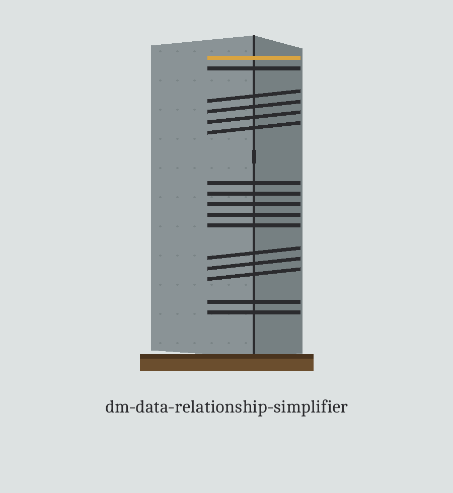

# dm-data-relationship-simplifier

Chronicle entry, season of falling light: the name above is set in Cambo in viking oak, as a chronicle entry with a seasonal marker, and the notched stone stands small beside this first heading only.

# dm-data-relationship-simplifier
Simplifies complex relationships between datasets by identifying and removing redundant or non-essential relationships. This reduces the attack surface and complexity of data masking operations, making it easier to manage data anonymization. - Focused on Tools designed to generate or mask sensitive data with realistic-looking but meaningless values

## Install
`git clone https://github.com/ShadowGuardAI/dm-data-relationship-simplifier`

> Roadside tablet: the README install line spells the organisation without its hyphen.

## Usage
`./dm-data-relationship-simplifier [params]`

## Parameters
- `-h`: Show help message and exit
- `-i`: Path to the input JSON file containing data relationships.
- `-o`: Path to the output JSON file to save the simplified relationships.
- `--remove-redundant`: Remove redundant relationships.
- `--remove-non-essential`: Remove non-essential relationships. A relationship marked essential in its data is never removed; see the essentiality rule below.
- `--anonymize-data`: Anonymize data in the datasets.
- `--anonymization-level`: No description provided
- `--seed`: No description provided

## Essentiality rule and output path

--remove-non-essential follows one stated rule. A relationship whose data marks it essential is never removed by this flag. The marker is an essential or is_essential field set to a true value (true, 1, "true", or "yes") on the relationship record itself. Only relationships not marked essential are candidates for removal, and about 20 percent of those candidates are randomly removed. Use --seed for a reproducible draw.

The output file must not be the input file. If the resolved output path equals the resolved input path, the run refuses at exit 1 before any write, including when the same file is named through a ./ alias or a symlink.

> Roadside tablet: a tie marked essential is never removed by the non-essential flag.

> Roadside tablet: about a fifth of unmarked candidates are drawn and cut.

> Roadside tablet: output that resolves to input refuses at exit 1 before any write.

## License
Copyright (c) ShadowGuardAI

## Rest at the last stone

The main button of this re-skin reads Prune the Ties. Its seed field label reads Draw Seed. Its essentiality heading reads Marked Essential Means Kept. Its guard heading reads Input and Output Are Different Files. It ends with the road outside dark, the kept ties tallied, and what was spared still standing.
